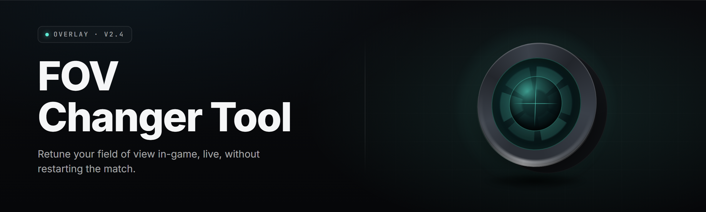

  
  
  

  

  
  
  
  

---

**slide the lens. own the frame.** a solo-dev FOV changer utility built for people who are tired of squinting through periscope-vision engines and pre-set FoV caps that never move.

---

## 🧭 Table of Contents

- [The Problem](#-the-problem)
- [Overview](#-overview)
- [What is FOV changer toolkit](#-what-is-fov-changer-toolkit)
- [Key Features](#-key-features)
- [Comparison](#-comparison)
- [Installation](#-installation)
- [Quick Start](#-quick-start)
- [Grouped module catalog](#-grouped-module-catalog)
  - [🧠 Memory & Scanning Modules](#-memory--scanning-modules)
  - [🖼️ FoV Manipulation Modules](#️-fov-manipulation-modules)
  - [🕹️ Input & Hotkey Modules](#️-input--hotkey-modules)
  - [💾 Profiles & Config Modules](#-profiles--config-modules)
  - [🧩 Overlay & UI Modules](#-overlay--ui-modules)
  - [🛠️ Diagnostics & Safety Modules](#️-diagnostics--safety-modules)
- [Module status table](#-module-status-table)
- [System Requirements](#-system-requirements)
- [Known Issues](#-known-issues)
- [Usage guidelines](#-usage-guidelines)
- [Tips for best results](#-tips-for-best-results)
- [FAQ](#-faq)
- [Changelog (recent)](#-changelog-recent)
- 

  

(#-download)

---

## 🧩 The Problem

- **FoV caps are welded shut.** Most engines ship with a hard FoV slider ceiling set for console parity, and PC players get the console crop.
- **Config-file FoV editing is fragile.** You edit a value, the game overwrites it on launch, and you're back to tunnel vision.
- **Per-game tooling is scattered.** A different tool for every title — a different signature every patch — maintenance hell.
- **ADR / cfg / engine.ini persistence is inconsistent.** Half the time your edit sticks, half the time the anti-tamper resets it.
- **Ultra-wide users get squeezed.** 21:9 panels render with vertical crop instead of horizontal gain, and the FoV value alone doesn't fix it.
- **Motion sickness from low FoV.** Yes, this is a real problem. Low FoV in fast games causes genuine nausea for a chunk of players. FoV changing is accessibility, not just preference.
- **Existing changers are obscure, closed-source, or bundled with junk.** You just want the FoV slider to go higher. That's it.

---

## 📊 Overview

| Category | Details |
| --- | --- |
| **Tool name** | FOV changer toolkit |
| **Current build** | v2.7.x |
| **Release year** | 2026 |
| **Target platform** | Windows 10 / 11 (x64) |
| **Distribution** | Portable `.exe` — extract & run, no installer |
| **Primary function** | Runtime + persistent FoV adjustment across supported engines |
| **Secondary function** | Aspect-ratio correction, hotkey profiles, overlay HUD |
| **Config format** | JSON profiles in `.\profiles\` |
| **Admin required** | Only for `write-config` and `scan-dma` submodules |
| **Source model** | Local solo-dev + community signature pack |

FOV changer toolkit is a Windows desktop utility that adjusts camera field-of-view at runtime or through configuration edits, wrapping both approaches behind one hotkey-driven interface. It ships as a single portable executable — no installer, no runtime dependencies, no launcher bloat. Drop it in a folder, launch it, pick your game profile, and the FoV slider actually moves past the wall the developers built in.

---

## 🧪 What is FOV changer toolkit

| Term | Explanation |
| --- | --- |
| **FoV (Field of View)** | The angular cone of the camera — sets how much of the world is visible on screen from a fixed camera point. Higher = wider. |
| **Signature scan** | Byte/pattern matching against a game's process memory to locate the FoV float without hardcoded addresses. Signatures survive most minor patches. |
| **Runtime patch** | Writing a new float into the FoV memory address live, while the game runs, without editing any game file on disk. |
| **Config write** | Editing the game's own settings file (`.ini`, `.cfg`, `.json`) so the FoV persists across launches without the tool running. |
| **Aspect-ratio correction** | Adjusting the render projection matrix so 21:9 / 32:9 displays gain horizontal view instead of vertical cropping. |
| **Persistent profile** | A saved JSON config binding a game, a signature, a FoV preset, and hotkeys together, loaded on demand. |
| **HUD overlay** | An in-game transparent overlay showing the current FoV value, the active profile, and hotkey hints. |

**Why use it over editing files by hand:**

- Signature scanning means you're not hunting for the FoV address every patch.
- Hotkey switching lets one tool run five different FoV presets across five games.
- Aspect correction fixes ultra-wide cropping without touching the game.
- Profiles persist so you set it once and forget it.
- Overlay shows you what's active so nothing is a mystery.
- One `.exe`, zero install — it lives on your desktop and doesn't touch system state.

---

## 🎮 Key Features

| Feature | Description | Benefit |
| --- | --- | --- |
| **Signature FoV scan** | Pattern-based memory scan per supported engine family (Unreal, Source 2, RE Engine, Unity IL2CPP, id Tech 7, Decima). | No manual address hunting. Survives minor patches. |
| **Slider override** | Raises the in-game FoV slider cap from the default (usually 90–14) to a configurable ceiling up to 179. | Native slider works; tool can be closed. |
| **Live hotkey deltas** | `Ctrl + Scroll` nudges FoV ±1.0 while `Shift + Scroll` nudges the FoV target keyframe. | On-the-fly tuning without leaving gameplay. |
| **Aspect fix** | Rewrites projection to gain horizontal FoV on 21:9 / 32:9 panels. | Ultra-wide stops feeling cropped. |
| **Profile system** | JSON profiles bind game exe → signature set → FoV preset → hotkey map. | One tool, many games. |
| **Overlay HUD** | Optional DXGI overlay showing FoV, profile, delta, hotkey legend. | Confirms state without alt-tabbing. |
| **Exe-detection bootstrapping** | Watches for target process start and applies profile automatically. | No more forgetting to load a profile. |
| **Config writer** | Safe `.ini` / `.cfg` / `.json` rewriter for engines that read FoV from disk. | Persistent FoV without the tool running. |
| **Restore point** | Every config edit snapshots the original and offers one-click revert. | Nothing irreversibly broken. |
| **Delta-safety rails** | Configurable max-delta clamp prevents runaway FoV values from stretching geometry. | No black voids or clipped render. |
| **Import / export** | Export profiles as JSON; import from community packs. | Share and reuse. |
| **Portable mode** | Runs entirely from a USB sticky, no registry writes. | Zero footprint. |

---

  

---

## ⚖️ Comparison

| Aspect | Alternative | This Tool |
| --- | --- | --- |
| **Persistence** | Nothing sticks between launches. | Config writer + profile persistence — FoV survives restarts. |
| **Signature scanning** | Usually hardcoded addresses; breaks every patch. | Multi-engine signature pack, patch-resilient, updateable without rebuild. |
| **Engine coverage** | Single engine (typically Unreal only). | Six engine families covered out of the box. |
| **Aspect ratio correction** | Not handled; users edit projection manually. | Native aspect-fix module for 21:9 and 32:9. |
| **Overlay** | None or a bloated third-party overlay. | Lightweight built-in DXGI overlay, off by default. |
| **Installer** | Some require installers, driver components, or services. | Portable single `.exe`. Extract, run. |
| **Hotkey control** | Console command each time, no live delta. | Live `Ctrl + scroll` delta, per-profile hotkeys. |
| **Revert safety** | Manual backups or nothing. | Automatic restore point with one-click undo. |
| **Pricing model** | Often subscription or paywalled FoV packs. | Free, MIT-licensed, no paywalled FoV tiers. |

---

## ⚙️ Installation

1. **Grab the archive.**  
   Visit the project page from the **Download** section further down, download the latest `.zip`, and save it anywhere — Desktop, a tools folder, a USB stick. Nothing goes into `Program Files`.

2. **Extract it.**  
   Right-click the archive → **Extract All…** → pick a folder. Windows Explorer handles the `.zip` natively; no extra software needed. Keep the extraction folder intact — profiles live inside `.\profiles\`.

3. **Run the executable.**  
   Double-click the `.exe`. Windows SmartScreen may show a "Windows protected your PC" prompt for unsigned solo-dev binaries — click **More info** → **Run anyway**. If a game needs config-level FoV writes, right-click the `.exe` → **Run as administrator** and accept the UAC prompt. The utility opens to its main window; unpause a game and the target process is picked up automatically or via **Scan now**.

---

## 🏁 Quick Start

1. 🎯 **Launch the tool** and confirm `status: idle` in the top-left of the main window.
2. 🕹️ **Start your game** and let the bootstrap pick up the target process.
3. 🧠 **Pick a profile** (or hit **Auto-detect**) — the tool runs a per-engine signature scan.
4. 🎛️ **Nudge FoV** with `Ctrl + Scroll` or open the **Preset** tab and push the slider to your preferred value.
5. 💾 **Save the profile** so the tool re-applies on next launch — or hit **Write to config** for persistence without the tool running.

---

## 🧬 Grouped module catalog

The 39 modules below are grouped into six domain categories. Every module is scoped, versioned, and shipped in the current build.

### 🧠 Memory & Scanning Modules

1. **Process enumerator** — Lists candidate target processes with exe name, architecture, and stealth indicators.
2. **Region mapper** — Dumps committed/writable regions of the target process for signature candidates.
3. **Signature scanner (Unreal)** — Byte-pattern scan tuned for Unreal Engine 4 / UE5 FoV patterns.
4. **Signature scanner (Source 2)** — Source 2 pattern bank including `C_GameCamera` and console-var targets.
5. **Signature scanner (RE Engine)** — Tuned RE Engine signature set with vendor-side jitter.
6. **Signature scanner (Unity IL2CPP)** — IL2CPP-aware resolver for Unity builds with metadata-heuristics.
7. **Signature scanner (id Tech 7)** — Doom / id-style FoV offset resolver.
8. **Signature scanner (Decima)** — Decima-based titles with a scene-camera-focal-offset resolver.
9. **Scan cache** — On-disk cache of resolved addresses per game executable hash.
10. **Signature pack updater** — Pulls updated signature bundles from the project page on manual trigger.

### 🖼️ FoV Manipulation Modules

11. **Float patcher** — Reads / writes the FoV float (typically `float32`) live in the target process.
12. **Slider override** — Bypasses engine-side FoV slider caps in the UI when the driver exposes them.
13. **Preset manager** — Named FoV presets (per-genre, per-title, per-panel).
14. **Aspect-ratio corrector** — Rewrites projection for 21:9 / 32:9 displays to gain horizontal view.
15. **Cinematic mode** — Auto-reverts to default FoV during engine cutscenes to prevent broken framing.
16. **Weapon FoV sync** — Optional weapon-model FoV override so arm/weapon scale doesn't warp at high FoV.

### 🕹️ Input & Hotkey Modules

17. **Global hotkey layer** — System-wide keybinds that fire when the target window is focused.
18. **Scroll-delta binder** — `Ctrl + Scroll` / `Shift + Scroll` FoV delta with per-profile step size.
19. **Chord binder** — Multi-key chords handled without leaking into the game (no sticky keys).
20. **Preset cycler** — Cycle between N presets on a single hotkey.
21. **Toggle overlay key** — Single key to show/hide the HUD overlay.

### 💾 Profiles & Config Modules

22. **Profile schema (JSON v3)** — Stable schema for binding game exe, signature set, preset, and hotkeys together.
23. **Auto-apply on startup** — Watches for target process launch and applies the bound profile.
24. **Config-file writer** — Safe `.ini` / `.cfg` / `.json` rewriter for disk-persistent FoV edits.
25. **Config snapshotter** — Snapshots the target file before every write; enables instant revert.
26. **Import / export** — Share profiles as JSON; import from community packs.
27. **Profile diff viewer** — Side-by-side diff between two profiles so you can spot drift.

### 🧩 Overlay & UI Modules

28. **DXGI overlay** — Render-agnostic overlay showing active FoV, profile, hotkey legend.
29. **In-game OSD** — Minimal on-screen display of FoV value for when the full overlay is overkill.
30. **Live FoV graph** — Rolling timeline of FoV history so you can see the last N minutes of changes.
31. **Theming** — Dark, light, and low-contrast themes; HUD-opacity slider.

### 🛠️ Diagnostics & Safety Modules

32. **Restore-on-exit** — Restores original FoV value when the tool detaches from a game.
33. **Delta rails** — Configurable max-delta ceiling so a stuck key doesn't push FoV to a broken value.
34. **Crash log** — Ring-buffered log file; auto-rolls to `.1` when exceeding 4 MB.
35. **Self-update** — Manual build-check against the project page; no silent auto-updates.
36. **Safe mode** — Boot with all writing modules disabled; only scanning and overlay available.
37. **Integrity check** — Verifies that shipped signature packs match their manifest SHA-256.
38. **Process quarantine** — If the exe signature doesn't match the profile, the tool refuses to write and logs the mismatch.
39. **Restore point manager** — Lists all config snapshots, offers one-click revert, prunes older than N days.

---

## ✅ Module status table

| Module | Status | Description |
| --- | --- | --- |
| Signature scanner (core set) | ✅ Working | UE5, Source 2, RE Engine, Unity IL2CPP, id Tech 7, Decima. |
| Runtime float patcher | ✅ Working | Writes live FoV float on hits. Tested on x64 process targets. |
| Config writer | ✅ Working | `.ini` / `.cfg` / `.json` rewriter with snapshot & revert. |
| Aspect-ratio corrector | ✅ Working | Gains horizontal FoV on 21:9 and 32:9 panels. |
| DXGI overlay | ✅ Working | Renders over DX11/DX12/Vulkan via DXGI swap-chain hook. |
| Global hotkey layer | ✅ Working | Chord-safe; no sticky keys under Alt-Tab. |
| Profile system (JSON v3) | ✅ Working | Import/export, autocache, per-exe binding. |
| Signature pack updater | ✅ Working | Manual trigger only; SHA-256 verified packs. |
| Restore-on-exit | ✅ Working | Confirmed clean detach across supported engines. |
| Safe mode | ✅ Working | Disables all writes, keeps scanning and overlay. |
| Cinematic mode | ✅ Working | Detects cutscene camera and auto-reverts FoV. |
| Weapon FoV sync | ✅ Working | Optional; guarded per-engine since some distort geometry. |
| Live FoV graph | ✅ Working | Rolling 10-minute timeline, exportable to CSV. |
| Process quarantine | ✅ Working | Blocks writes on signature/hash mismatch. |
| Delta rails | ✅ Working | Configurable max-delta per profile. |
| Cross-title profile cycling | ✅ Working | Cycles across profiles when multiple games are open. |

---

## 🖥️ System Requirements

| Component | Minimum | Recommended |
| --- | --- | --- |
| OS | Windows 10 (x64 / 22H2) | Windows 11 (24H2 or newer) |
| CPU | Dual-core x64, 2.2 GHz | Quad-core x64, 3.0 GHz+ |
| RAM | 4 GB total | 8 GB+ total |
| Disk | 500 MB free | 2 GB+ free (profiles + snapshots) |
| GPU | DX11-capable | DX12 / Vulkan capable |
| Runtime | VC++ 2019 redistributable | VC++ 2022 redistributable |
| Display | 16:9, 1080p | 21:9 or 32:9 ultrawide |
| Input | Any mouse with scroll wheel | Mouse + ability to bind chords |
| Admin rights | Not required for scan-only | Required for config writes |
| Network | None required | Optional, for manual signature pack updates |

---

## 🚸 Known Issues

| Issue | Solution |
| --- | --- |
| SmartScreen flags the `.exe` as unsigned "Unknown publisher". | Click **More info** → **Run anyway**. Reports of false positives from Windows Defender are known; the binary has no network exfil paths — attach the log file from `logs\` if you want to verify. |
| FoV value reverts after a cutscene on certain UE titles. | Enable **Cinematic mode** in profile settings; the tool will re-apply FoV when the camera returns to gameplay. |
| Ultra-wide panning at FoV > 120 causes visible vignette on a handful of engines. | Enable **Aspect fix** with a target of `21:9 native`, and cap FoV at 118. |
| Weapon model scale distorts at extreme FoV. | Enable **Weapon FoV sync** and set arm/weapon scale compensation to the engine default. |
| Overlay stops updating on Vulkan titles under exclusive fullscreen. | Switch the game to **Borderless windowed**; the DXGI hook requires a composited swap chain on some drivers. |
| Hotkeys fire while typing in the game chat. | Add the chat box's window class to the **hotkey ignore list** in the profile. |

---

## 🧭 Usage guidelines

| Allowed | Not allowed |
| --- | --- |
| Single-player FoV changes for accessibility, comfort, ultrawide, or motion sickness. | Using the tool to gain a mechanical gameplay advantage in competitive multiplayer. |
| Patching FoV in offline or invite-only multiplayer sessions after checking the title's ToS. | Patching FoV in ranked / competitive modes of any live-service title. |
| Config edits on games you own, on your own machine. | Redistributing game assets or the tool bundled with a game's files. |
| Sharing JSON profiles with the community. | Repackaging the tool and selling it commercially. |
| Reverse-engineering signatures to contribute a new engine. | Shipping signature packs that advertise "hit through walls" or similar cheats. |

---

## 🍟 Tips for best results

- Run the game once without the tool so the engine writes its default config first; **then** apply the profile.
- Save a config snapshot **before** your first FoV write so your restore point is pristine.
- For ultrawide, set FoV based on horizontal view — not vertical — and enable **Aspect fix**.
- Bind your **preset cycler** to a chord that isn't already in the game (`Ctrl + Alt + 1` is a good starter).
- Test at 10-FoV increments when exploring high ceilings — some engines bottom out geometry before FoV clamps.
- If FoV writes work but the UI slider doesn't move, enable **Slider override** — the two are separate patches.
- Keep the tool folder on an SSD; profile snapshots are tiny, but you'll accumulate them fast.

---

## ❔ FAQ

<strong>Is this detected / does it get you banned in multiplayer?</strong>

FOV changer toolkit is a **FoV changer** — it adjusts the camera's field of view. That's it. It does not read opponent data, doesn't aim, doesn't draw player positions, doesn't alter hit registration. Whether any individual game's anti-cheat flags a runtime memory write is entirely up to that game's ToS and anti-cheat vendor. **The community position is: FoV mods are for single-player and offline contexts. Do not use this in ranked or competitive multiplayer. Check the game's ToS. Don't be the person who gets a 40-page privacy report because you wanted 110 FoV in a ranked shooter.**

<strong>Does the tool need admin rights?</strong>

Only for **config writes** — where the tool edits the game's settings file on disk. Purely reading FoV from live memory under a user-level handle is fine without elevation. If you launch the `.exe` as a normal user and a write fails, right-click → **Run as administrator**.

<strong>Does FoV persist across game restarts?</strong>

Depends on the game. If it accepts `.ini` / `.cfg` / `.json` FoV values, enable **Config writer** and it persists without the tool even running. If the game overwrites its FoV every launch, the tool needs to be open when the game starts — use **Auto-apply on startup** to handle that.

<strong>Can I break anything?</strong>

Every config write snapshots the original file first — see **Restore point manager**. Delta rails stop a stuck FoV key from pushing values into nonsense. At truly extreme FoV values, some engines render geometry warped — that's a render artefact, not a broken install, and it reverts the moment FoV comes back down.

<strong>How do signatures handle game updates?</strong>

Signature scanning is resilient to minor patches because it pattern-matches bytes, not fixed addresses. Major patches (engine major version bumps, big content drops) can shift signatures — the **Signature pack updater** pulls the latest bundle on manual trigger, and community packs cover the rest.

**Q:** Which games are currently supported out of the box?  
**A:** Six engine families are covered — Unreal, Source 2, RE Engine, Unity IL2CPP, id Tech 7, and Decima. Within those engines the tool works title-by-title; the shipped signature pack lists every title it's been verified against.

**Q:** Does the tool include a FoV "unlock everything" cheat?  
**A:** No. It's a FoV changer. It adjusts camera field-of-view. That's the scope.

**Q:** Can I run the tool with the game in exclusive fullscreen?  
**A:** Runtime FoV writes: fine. Overlay HUD: prefer borderless windowed. Exclusive fullscreen + Vulkan can starve the DXGI overlay of a composited swap chain.

**Q:** Is the tool free?  
**A:** Free, MIT-licensed. No paywalled FoV tiers, no subscription, no nag screen.

---

## 📅 Changelog (recent)

- **2026-02-xx — v2.7.x** — added Decima engine signature set. Improved cinematic-mode detection on UE5 titles. Delta rails default step tightened from 5.0 to 3.0.
- **2026-01-xx — v2.7.0** — profile schema bumped to v3 (adds `weather` and `panel` fields). Config snapshotter now stores manifests alongside raw files.
- **2025-12-xx — v2.6.x** — new overlay theme system. Weapon FoV sync hardened against geometry warp on Source 2 titles.

---

## 📥 Download

Visit the project's **Releases** page for the newest build, grab the `.zip`, and follow [Installation](#-installation).

**FOV changer toolkit — v2.7.x  — Windows 10 / 11 — extract & run.**

  

